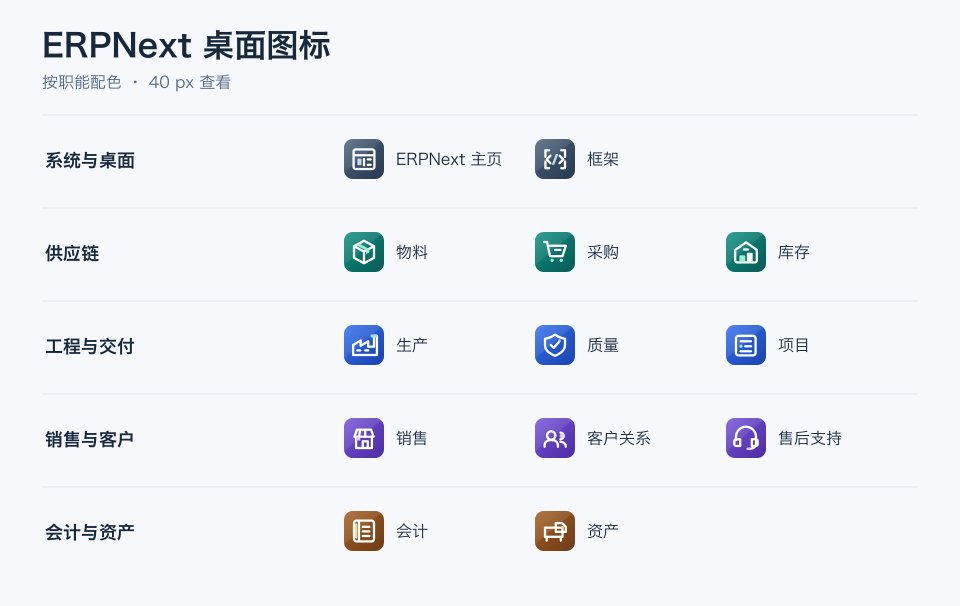

# ERPNext v16 简体中文界面补译与桌面图标

在 Frappe 与 ERPNext 自带的简体中文基础上，补充物料和桌面导航的高频词条。另附 13 枚桌面图标，覆盖采购、库存、生产、销售、会计等工作区。实测环境为 Frappe **16.53.0**、ERPNext **16.52.1**。



## 补译范围

使用 Frappe 原生 `Translation` 记录，语言代码为 `zh`。19 条词条保存在 [translations.csv](translations.csv)，含 `Item → 物料`、`All apps → 返回桌面`、侧边栏展开及收起、桌面布局操作、工作区问候语和引导进度。导入时保留站点已有的自定义译文并输出冲突清单。

Frappe v16 的基础翻译来自应用自带的 Gettext 词库。当前版本的 `Item` 作为独立来源词条缺失，所以列表标题和面包屑回退为英文。站点词条可补齐经翻译函数渲染的文本。某些标签需要在上游代码中先接入 `__()`，例如部分 v16 构建中桌面标签标题的字面量 `Desktop`。本包只改站点配置和词条，核心文件由原应用维护。 [Frappe v16 迁移说明](https://github.com/frappe/frappe/wiki/Migrating-to-version-16) · [Bench 翻译命令](https://docs.frappe.io/framework-copy/bench/overview)

## 使用方式

把仓库下载到可访问 Bench 的环境。在 Bench 根目录下，由有权维护本站的用户运行以下命令。容器部署时，在挂载该站点目录的后端容器里使用同一 Bench Python 环境。

```sh
bench --site your-site backup
./env/bin/python /path/to/erpnext-v16-zh-cn-ui/install.py --site your-site
./env/bin/python /path/to/erpnext-v16-zh-cn-ui/install.py --site your-site --apply
```

需要同批安装桌面图标时，在预览和应用两条命令末尾都加 `--icons`。该选项更新与映射名称匹配的原生链接型 `Desktop Icon`，沿用现有路由、角色和排序。预览会列出跳过的图标。当前选了「应用」模式或没有桌面图标记录的站点，可单独使用补译，或按 [Frappe 桌面文档](https://docs.frappe.io/framework/user/en/desk/navigation/desktop) 配置「桌面图标」后再预览。

应用后在 ERP 选择简体中文并刷新。已有会话可从用户菜单选「刷新」，再验证物料列表标题、面包屑和桌面入口。安装器为修改范围保存私有 JSON 恢复记录。需要撤销时，用记录中 `translation_keys_added` 删除此次新增的 `zh` 词条，用 `icons_before` 恢复图标的 `app` 和 `logo_url`，然后刷新缓存。若部署后手工修改过同一字段，先对照当前值再回退。

## 图标规范

所有图标沿用 `96 × 96` 网格、白色圆角几何笔画、斜切高光和单色点缀。图形是主要辨识线索，颜色辅助区分职能。按约 40 px 的实际显示大小检查识别度。

| 职能 | 配色 | 模块 |
| --- | --- | --- |
| 系统与桌面 | 石板灰 `#4A627B → #26394F` | ERPNext 主页、框架 |
| 供应链 | 青绿 `#0C8E81 → #075A54` | 物料、采购、库存 |
| 工程与交付 | 蓝色 `#306DEE → #1B43AD` | 生产、质量、项目 |
| 销售与客户 | 紫色 `#7651D9 → #4C2CA2` | 销售、客户关系、售后支持 |
| 会计与资产 | 琥珀 `#A35D20 → #6D3C16` | 会计、资产 |

现有状态颜色和表单行动图标沿用各自的语义。新增工作区优先复用现有职能色，并以独立符号表示功能。SVG 源文件位于 [icons/](icons/)。

## 社区方案对照

- [custom_translations](https://github.com/534627605/custom_translations) 可作为更大覆盖范围的独立应用评估，提供词库、扫描及自动化功能。安装前核对覆盖的术语和附加钩子。
- [erpnext-zh-cn-patch](https://github.com/marvinyen/erpnext-zh-cn-patch) 面向 v16，提供批量补全与安装脚本。脚本会写入核心语言文件、导入数据库并重启容器。
- [erpnext_chinese](https://github.com/SolutionAlliance/erpnext_chinese) 是较早的 CSV 汉化方案。安装文档以旧版为基础，当前 v16 环境应先做版本兼容测试。

## 维护

新增译文时记录准确的来源词条，保留 `{0}` 等格式占位符，并在真实页面验收。希望长期修复的通用词条与未调用翻译函数的标题，可提交到对应上游项目。

```sh
python3 -m unittest discover -s tests
```

## English

A small, reviewed Simplified Chinese overlay and optional color-coded SVG launcher pack for ERPNext v16. The installer previews by default, preserves local translations and updates only existing matching Link icons. Run it with the Bench virtual environment and enable `--apply` only after reviewing the plan.
